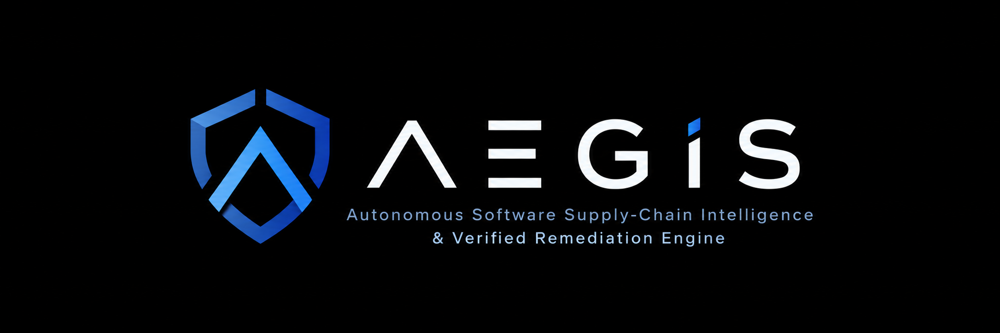

  

<h1 align="center">AEGIS</h1>

  <strong>Autonomous Software Supply-Chain Intelligence & Verified Remediation Engine</strong>

  Evidence-driven dependency security. Verified remediation.

AEGIS is an early-stage Python project exploring how developers can investigate vulnerable dependencies, evaluate remediation options, and verify the outcomes of dependency changes.

Project Goals

AEGIS aims to help developers:

Identify known vulnerabilities in project dependencies.
Understand dependency constraints and remediation options.
Investigate why a proposed dependency update may fail.
Evaluate changes in an isolated environment.
Collect test and security-scanning evidence for human review.

These are project goals, not claims about currently implemented capabilities.

Current Status

Status: Initial development

The project is currently establishing its Python package structure, development tooling, and automated testing foundation.

Dependency analysis, vulnerability investigation, remediation, and verification workflows have not yet been implemented.

Development
Requirements
Python 3.10 or later
Git
Setup

Clone the repository, navigate to its root directory, and create a virtual environment:

python -m venv .venv
.\.venv\Scripts\Activate.ps1
python -m pip install -e ".[dev]"
Run tests
python -m pytest
Check code quality
python -m ruff check .
python -m ruff format --check .
Design Principles
Evidence over assumptions: distinguish observed results from hypotheses.
Isolation: evaluate dependency changes in controlled environments.
Reproducibility: make commands, test results, and decisions traceable.
Transparency: report limitations and failed checks honestly.
Incremental engineering: build and validate small, testable components.
Project Scope

AEGIS is not intended to replace vulnerability databases, package managers, dependency scanners, or CI systems. Its intended value is to help developers investigate remediation problems and understand the evidence supporting a proposed change.

That value remains a hypothesis to validate through implementation and evaluation.

Contributing

Contribution guidelines will be added as the project matures. During early development, keep changes small, run the test suite, and document significant design decisions.

License

The project license has not yet been selected.