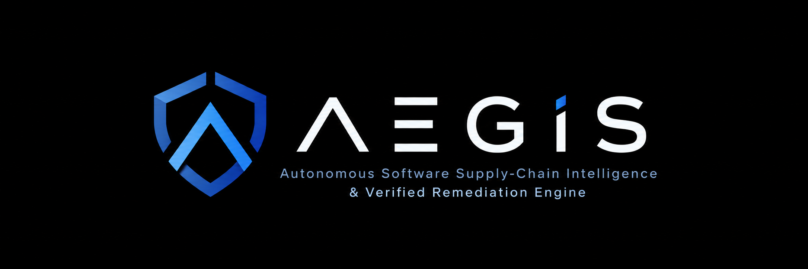

<div align="center">

  

  <h1>AEGIS</h1>

  <h3>Autonomous Software Supply-Chain Intelligence &amp; Verified Remediation Engine</h3>

  <p><strong>Understand the risk. Investigate the fix. Verify the outcome.</strong></p>

  <p>
    An evidence-driven Python CLI for dependency investigation,
    vulnerability intelligence and remediation analysis.
  </p>

  <p>
    
    
    
    
    
    
    
  </p>

  <p>
    <a href="#overview">Overview</a> ·
    <a href="#features">Features</a> ·
    <a href="#architecture">Architecture</a> ·
    <a href="#getting-started">Installation</a> ·
    <a href="#usage">Usage</a> ·
    <a href="#roadmap">Roadmap</a>
  </p>

  <p>
    <a href="docs/ARCHITECTURE.md">
      <strong>Architecture</strong>
    </a>
    &nbsp; · &nbsp;
    <a href="docs/ROADMAP.md">
      <strong>Roadmap</strong>
    </a>
    &nbsp; · &nbsp;
    <a href="LICENSE">
      <strong>License</strong>
    </a>
  </p>

</div>

---

## Overview

Modern software applications depend on increasingly complex ecosystems of third-party packages and libraries.

These dependencies introduce security risks that can be difficult to identify, investigate and resolve reliably.

**AEGIS (Autonomous Software Supply-Chain Intelligence & Verified Remediation Engine)** is an early-stage Python CLI designed to make dependency investigation more structured, transparent and evidence-driven.

It discovers supported Python dependency manifests, builds a source-aware dependency inventory, optionally queries vulnerability information from OSV.dev, and generates structured JSON and human-readable Markdown reports.

The broader engineering objective is to investigate how dependency vulnerabilities can be analyzed, potential fixes evaluated, and remediation outcomes verified through reproducible evidence.

### The central idea

Finding a vulnerable dependency is only the beginning.

A meaningful remediation workflow must investigate:

* Which dependency is involved?
* Where was it declared?
* What vulnerability information is available?
* Which versions are reported as fixed?
* Is a proposed update compatible?
* What verification was actually performed?
* What evidence supports the final conclusion?

AEGIS is designed around this distinction between **detecting a potential risk and establishing evidence that a remediation is acceptable.**

> **Security and maturity:** AEGIS is currently a research/MVP tool, not a complete security scanner or hardened remediation agent. A clean scan does not prove a project is secure. Network results may be incomplete, and dependency metadata alone cannot establish runtime compatibility.

## Features

| Capability                 | Description                                                      | Status      |
| -------------------------- | ---------------------------------------------------------------- | ----------- |
| Manifest Discovery         | Discover root-level Python dependency manifests                  | Implemented |
| Requirements Parsing       | Parse PEP 508 declarations with source and line provenance       | Implemented |
| PyProject Parsing          | Parse PEP 621 dependencies and optional dependencies             | Implemented |
| Dependency Inventory       | Build a source-aware dependency inventory                        | Implemented |
| Analysis Issues            | Surface unsupported declarations and incomplete analysis         | Implemented |
| Vulnerability Intelligence | Query OSV.dev for PyPI package vulnerability information         | Implemented |
| Fixed-Version Candidates   | Conservatively extract fixed-version candidates from OSV records | Implemented |
| JSON Reporting             | Generate structured analysis reports                             | Implemented |
| Markdown Reporting         | Generate human-readable reports                                  | Implemented |
| Workspace Preparation      | Create disposable project copies for future verification work    | Implemented |
| Automated Testing          | pytest test suite                                                | Implemented |
| Code Quality               | Ruff linting and formatting                                      | Implemented |
| Automated CI               | GitHub Actions workflow                                          | Configured  |

## How AEGIS Works

The current workflow is read-only with respect to the target project's dependency files.

```text
             TARGET PYTHON PROJECT
                       |
                       v
                PROJECT DISCOVERY
                       |
                       v
                MANIFEST DISCOVERY
                       |
              +--------+--------+
              |                 |
              v                 v
        requirements.txt    pyproject.toml
              |                 |
              v                 v
       REQUIREMENTS PARSER  PYPROJECT PARSER
              |                 |
              +--------+--------+
                       |
                       v
              DEPENDENCY INVENTORY
                       |
                       v
               VULNERABILITY CHECK
                       |
                       v
                    OSV.dev
                       |
                       v
               ANALYSIS FINDINGS
                       |
              +--------+--------+
              |                 |
              v                 v
          JSON REPORT      MARKDOWN REPORT
```

Workspace preparation is a separate operation. It creates a disposable copy of a project but does not install dependencies or execute project code.

## Architecture

AEGIS follows a modular Python architecture with separate responsibilities for discovery, parsing, analysis, vulnerability intelligence, reporting and workspace preparation.

### Component Responsibilities

| Component              | Responsibility                                                   |
| ---------------------- | ---------------------------------------------------------------- |
| CLI                    | Exposes commands and user-facing configuration                   |
| Discovery              | Identifies supported dependency manifests                        |
| Parsing                | Converts dependency declarations into structured representations |
| Analysis               | Coordinates project analysis and collects findings               |
| Vulnerability          | Integrates with OSV.dev                                          |
| Models                 | Defines structured analysis data                                 |
| Reporting              | Generates JSON and Markdown reports                              |
| Verification Workspace | Prepares disposable project copies for future verification work  |

### Engineering Principles

**1. Source-aware analysis**

Dependency findings retain information about their original source, allowing developers to trace declarations back to project files and locations.

**2. Explicit limitations**

Unsupported declarations and incomplete checks are surfaced as issues rather than silently ignored.

**3. Read-only investigation**

Scanning does not silently modify dependency manifests or execute target project code.

**4. Evidence over assumptions**

Vulnerability records and fixed-version candidates are presented as investigation evidence, not automatic proof of exploitability or compatibility.

**5. Separation of concerns**

Discovery, parsing, vulnerability queries, reporting and workspace preparation remain separate components.

## Technology Stack

| Layer                      | Technology      | Purpose                          |
| -------------------------- | --------------- | -------------------------------- |
| Language                   | Python 3.10+    | Core application                 |
| Dependency parsing         | packaging       | PEP 508 requirement parsing      |
| Configuration parsing      | tomllib / tomli | TOML processing                  |
| Vulnerability intelligence | OSV.dev         | Public vulnerability information |
| CLI                        | Python argparse | Command-line interface           |
| Data models                | Python          | Structured analysis results      |
| Testing                    | pytest          | Automated tests                  |
| Code quality               | Ruff            | Linting and formatting           |
| Version control            | Git             | Source control                   |
| CI                         | GitHub Actions  | Automated checks                 |

## Getting Started

### Requirements

* Python 3.10 or newer.
* Git.
* pip.
* Network access for live OSV.dev vulnerability queries.

Network access is optional when using offline mode.

### 1. Clone the repository

```bash
git clone YOUR_AEGIS_REPOSITORY_URL
cd aegis
```

Replace the repository URL with your actual GitHub repository URL.

### 2. Create a virtual environment

**Windows PowerShell**

```powershell
python -m venv .venv
.\.venv\Scripts\Activate.ps1
```

**Linux / macOS**

```bash
python3 -m venv .venv
source .venv/bin/activate
```

### 3. Upgrade pip

```bash
python -m pip install --upgrade pip
```

### 4. Install AEGIS

Install the package with its development dependencies:

```bash
python -m pip install -e ".[dev]"
```

This installs the project in editable mode and makes the `aegis` CLI available in the activated environment.

### 5. Verify installation

```bash
aegis --help
```

Inspect the available commands and options.

## Usage

AEGIS exposes a command-line interface for dependency investigation and workspace preparation.

### 1. Run a dependency scan

Perform a read-only scan with online OSV.dev queries:

```bash
aegis scan /path/to/project
```

**Windows example:**

```powershell
aegis scan "C:\path\to\project"
```

### 2. Run an offline scan

Skip online vulnerability queries and perform a deterministic dependency inventory:

```bash
aegis scan ./sample-project --offline
```

### 3. Configure report output

Choose custom JSON and Markdown output paths:

```bash
aegis scan ./sample-project --timeout 20 --json reports/scan.json --markdown reports/scan.md
```

The timeout controls the configured OSV query timeout.

### 4. Use vulnerability findings as a CI gate

Return exit code `1` if OSV records were returned:

```bash
aegis scan ./sample-project --fail-on-vulnerability
```

This is a simple record-based gate. It does not establish that every returned record applies to the exact resolved dependency version.

### 5. Prepare a disposable workspace

Create a copy of a target project:

```bash
aegis prepare-workspace ./sample-project
```

Choose a custom destination:

```bash
aegis prepare-workspace ./sample-project --destination ./tmp/aegis-copy
```

The destination must not already exist.

The workspace preparation command copies project files while excluding common version-control, environment and cache directories.

**Important:** This is a project-copy operation, not a secure sandbox. It does not execute code or install packages.

## Reports and Exit Codes

AEGIS produces two report formats.

### JSON Report

`aegis-report.json`

A structured report containing:

* Dependency information.
* Analysis findings.
* Source locations.
* Vulnerability information.
* Analysis issues.
* Check status information.

### Markdown Report

`aegis-report.md`

A human-readable report designed to make dependency investigation results easier to inspect and review.

### Exit Codes

| Exit Code | Meaning                                                                                         |
| --------- | ----------------------------------------------------------------------------------------------- |
| `0`       | Static analysis completed without reported parsing/query issues, or offline inventory completed |
| `1`       | `--fail-on-vulnerability` was requested and OSV returned one or more records                    |
| `2`       | Invalid input or incomplete analysis                                                            |

Always inspect report status fields and issues to understand which checks actually ran.

### Interpreting Results

A vulnerability record does not automatically prove that the exact declared dependency version is affected.

Similarly, zero returned vulnerability records do not prove that a dependency is safe.

The initial implementation uses package-level OSV queries. These are not a replacement for lockfile-aware dependency resolution and complete affected-version range evaluation.

## Supported Inputs and Current Limitations

| Input              | Current Behavior                                                                                                    |
| ------------------ | ------------------------------------------------------------------------------------------------------------------- |
| `requirements.txt` | Supports PEP 508 declarations, blank lines, full-line comments and simple backslash continuations                   |
| `pyproject.toml`   | Supports PEP 621 `[project.dependencies]` and `[project.optional-dependencies]`                                     |
| Pip directives     | Options, nested includes, editable/VCS installs and index directives are reported as unsupported                    |
| Poetry / PDM       | Poetry/PDM-specific dependency layouts are not resolved                                                             |
| Lockfiles          | Lockfile-aware resolution is not implemented                                                                        |
| Vulnerability Data | Public OSV.dev query API for PyPI packages                                                                          |
| Remediation        | Reports fixed versions present in vulnerability data; does not modify manifests or guarantee compatibility          |
| Verification       | Workspace-copy preparation only; no package installation, arbitrary command execution or application test execution |

## Development

### Run Tests

```bash
python -m pytest
```

### Check Code Quality

```bash
python -m ruff check .
```

### Check Formatting

```bash
python -m ruff format --check .
```

These commands help maintain consistent formatting, code quality and expected behavior as the project evolves.

## Project Structure

The repository uses a modular Python source layout.

```text
aegis/
│
├── .github/
│   └── workflows/
│
├── assets/
│   └── aegis-logo.png
│
├── docs/
│   ├── ARCHITECTURE.md
│   └── ROADMAP.md
│
├── src/
│   └── aegis/
│       ├── discovery/
│       ├── parsing/
│       ├── analysis/
│       ├── vulnerability/
│       ├── reporting/
│       ├── verification/
│       ├── models.py
│       └── cli.py
│
├── tests/
│
├── pyproject.toml
├── README.md
└── LICENSE
```

*The diagram illustrates the architectural organization; consult the repository for the exact current file list.*

## Roadmap

AEGIS is being developed incrementally. The following improvements represent future engineering milestones rather than currently implemented features.

### Dependency Intelligence

* [ ] Lockfile-aware dependency resolution.
* [ ] More complete dependency relationship analysis.
* [ ] Version-range applicability analysis.
* [ ] Expanded ecosystem support.

### Verified Remediation

* [ ] Evaluate candidate dependency upgrades.
* [ ] Container-isolated verification.
* [ ] Before-and-after evidence collection.
* [ ] Dependency compatibility assessment.
* [ ] Reproducible remediation reports.

### Reporting and Integration

* [ ] SBOM generation.
* [ ] SARIF output.
* [ ] CI/CD integration improvements.
* [ ] Expanded security reporting.

### Advanced Investigation

* [ ] Optional auditable AI-assisted investigation.
* [ ] Dependency setup-failure diagnosis.
* [ ] Cloud and runtime compatibility assessment.
* [ ] More comprehensive verification workflows.

See the detailed project documents:

* [Architecture](docs/ARCHITECTURE.md)
* [Roadmap and future scope](docs/ROADMAP.md)

## Responsible Use

AEGIS is intended to assist with dependency investigation, not to certify that a software project is secure.

* Only analyze projects you are authorized to inspect.
* Review external vulnerability records before making security decisions.
* Evaluate proposed dependency upgrades before applying them.
* Do not execute untrusted projects in ordinary temporary directories and assume they are isolated.
* Treat incomplete analysis and missing vulnerability data as uncertainty, not proof of safety.

## Contributing

Contributions, suggestions and discussions are welcome.

1. Fork the repository.
2. Create a focused feature branch.
3. Implement your changes.
4. Add or update tests.
5. Run pytest and Ruff checks.
6. Submit a pull request with a clear explanation.

Contributions should preserve the project's focus on explicit behavior, traceable evidence and safe dependency investigation.

## License

MIT License. See [LICENSE](LICENSE) for details.

---

<div align="center">

  

  <h3>AEGIS</h3>

  <p><strong>Understand the risk. Investigate the fix. Verify the outcome.</strong></p>

<sub>Evidence-driven software supply-chain investigation.</sub>

</div>
